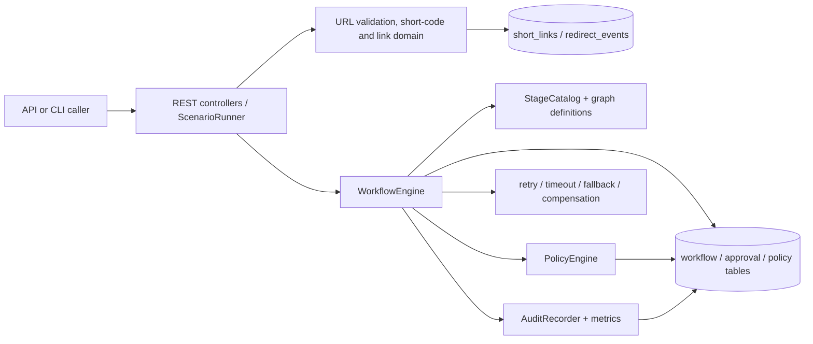

# Architecture overview

## Purpose

The application exposes a local URL-shortener API and a restart-safe, persisted engineering
workflow engine in one Spring Boot process. The two surfaces share an H2 store but keep domain,
orchestration, policy, reliability, and observability responsibilities separate.

## Component boundaries

- `api` owns link, redirect, analytics, health, and error contracts.
- `domain` owns URL validation, expiration, and short-code generation rules.
- `persistence` owns link and redirect JPA records.
- `orchestration` owns durable graphs, execution, gates, replanning, recovery, and stage scope.
- `policy` loads and evaluates versioned controls from `policies/v1.yaml`.
- `reliability` owns retry classification, timeouts, and compensation registration.
- `observability` owns workflow/audit APIs, consolidated event recording, and metrics.
- `scenarios` is a CLI evidence adapter; it does not replace the production engine.

## Control flow: brownfield scenario

`ScenarioRunner` selects `BrownfieldWorkflowGraph`, and `WorkflowEngine.submit` validates the DAG
and catalog identity before persisting the instance and every step configuration. The engine runs
requirement stages, conditionally skips clarification, then stops at design approval. Once approved,
seven impact handlers become eligible together. Their persisted end times must all precede the
joined `change_impact_report` start. That report is an exit gate; implementation cannot be claimed
until the decision is recorded. Implementation evidence is checked by the production policy engine,
testing/security/documentation converge at release readiness, and the approved readiness result
unblocks the final summary. Each transition and rejected action is written through `AuditRecorder`.

On restart, `WorkflowRecoveryRunner` reconstructs definitions from `workflow_steps` plus stable
catalog keys. An abandoned `RUNNING` step is reset for idempotent execution; an unknown catalog key
safe-stops that workflow without preventing application startup.

## Trust and failure boundaries

- URL input is restricted to HTTP(S), resolved before persistence, and rejects loopback, private,
  link-local, multicast, and IPv6 ULA targets.
- Only transient stage failures retry. Permanent failures do not retry.
- A registered fallback runs once after primary exhaustion and is visibly recorded as
  `SUCCEEDED_WITH_FALLBACK`; otherwise compensation is attempted before safe-stop.
- Mandatory policy failure blocks continuation unless a scoped, unexpired exception exists.
- Approval silence never implies approval. Rejection blocks the affected plan version.
- Stage persistence authority is represented by `StageScopedStepCapability`; a different-row write
  is rejected and audited before mutation.

## Architecture decisions

| ADR | Decision | Consequence |
|---|---|---|
| ADR-001 | Java 21 and Spring Boot | One mainstream, testable runtime and framework |
| ADR-002 | File-mode H2 with JPA | Durable local demonstration without external infrastructure |
| ADR-003 | Database-backed generated short code | Uniqueness is enforced at persistence boundary |
| ADR-004 | Explicit persisted DAG engine | State, dependencies, gates, and replans are inspectable |
| ADR-005 | No external orchestration product | Keeps assessment mechanics visible in repository code |
| ADR-006 | Explicit approval records | Decisions, actors, rationales, and plan versions remain auditable |
| ADR-007 | Versioned YAML policy file | Controls are data-driven and policy evaluations are persisted |
| ADR-008 | Local bounded parallel execution | Independent eligible siblings overlap; no distributed claim |
| ADR-009 | Rollback versus compensation | Transaction rollback covers local effects; registered actions cover external effects |
| ADR-010 | Loopback-only, no authentication | Acceptable only for this local demonstration; production deployment is blocked without auth |

## Persistence model

`short_links` and `redirect_events` hold domain state. `workflow_instances`, `workflow_steps`,
`workflow_events`, `approvals`, `policy_evaluations`, and `policy_exceptions` hold orchestration and
governance state. The field-level contract is in
`specs/001-agentic-url-shortener/data-model.md`; the HTTP contract is in
`specs/001-agentic-url-shortener/contracts/openapi.yaml`.
